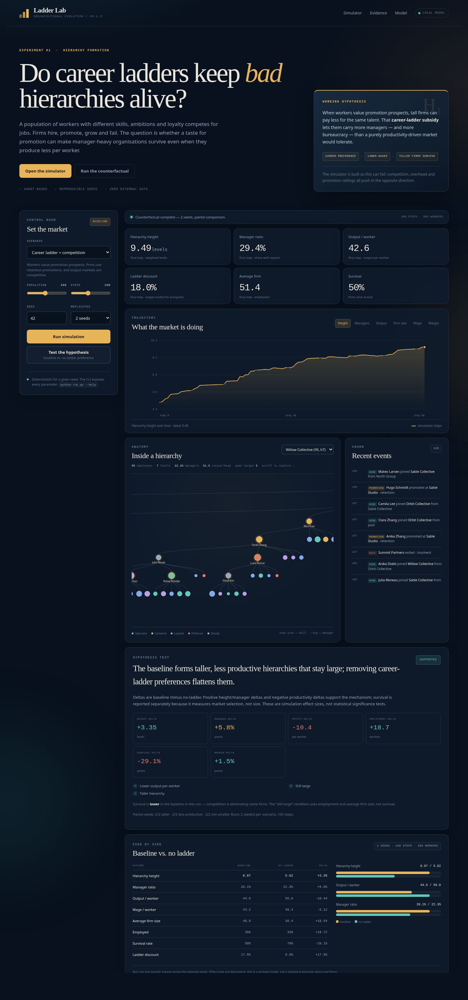

# OrgHierarchySim

**Ladder Lab** is an initial, runnable agent-based model of **organisation formation and evolution**.
A pool of workers with different skills, ambitions, hierarchy support and mobility
forms firms; firms hire, promote, grow and fail; the resulting population of
organisations evolves under an output market.

The app is built to test one hypothesis:

> **Organisations will form large hierarchies that can be relatively unproductive
> but remain large because employees desire a career ladder and therefore support
> the hierarchy, even though competitive pressures act against this.**



The model is deliberately stylised. It is useful for exploring the *logic* of the
hypothesis and for finding the conditions under which it does or does not hold;
it is not calibrated to real organisations and its output is not an empirical
estimate.

---

## Quick start

Requires Python 3.10+ and no third-party packages for the simulator or CLI.
The optional browser UI uses Flask.

```bash
cd OrgHierarchySim

# Quick two-scenario demonstration (baseline vs no-ladder)
python run.py demo

# One detailed baseline run
python run.py run --scenario baseline --steps 120 --population 360

# Full comparison across scenarios and seeds
python run.py experiment --seeds 11,23,37 --steps 100 --population 360

# Interactive local UI at http://127.0.0.1:5050
python run.py web
```

`python -m orgsim ...` works too. The experiment command writes:

- `results/experiment.json` — full aggregates, per-seed runs and hypothesis test
- `results/summary.csv` — one row per scenario
- `results/experiment_report.txt` — the printed report

Use `python run.py list` to see the scenarios. Any config field can be overridden
for an experiment, for example:

```bash
python run.py run --set competition=1.2 --set career_ladder_weight=0.45
```

For the web UI, install Flask if it is not already present:

```bash
python -m pip install -r requirements.txt
# or: python -m pip install -e '.[web]'
```

---

## The hypothesis in model terms

The model contains two channels through which a career ladder can sustain a tall
hierarchy:

1. **Compensating differentials.** Workers value promotion prospects. A firm with
   more levels and more expected vacancies can offer a lower wage for the same
   worker because the job is more attractive. The wage saving offsets some of the
   cost of managers.
2. **Retention promotions.** When workers value the ladder, firms can respond to
   retention pressure by creating an extra team/managerial rung instead of paying
   a large cash premium. This adds overhead and layers.

Competitive pressure works against this:

- managers cost more than individual contributors and produce only part of the
  direct output;
- extra layers create coordination/bureaucracy drag;
- output prices fall as industry output rises;
- loss-making firms shrink and eventually fail;
- there is a manager-ratio ceiling beyond which firms stop adding retention
  promotions.

The counterfactual sets `career_ladder_weight = 0` and disables retention
promotions. Workers then choose jobs on wage, hierarchy affinity, firm age and
switching costs only. If the hypothesis is doing real work, removing this channel
should flatten firms and raise output per worker without making the remaining
firms tiny.

---

## Model outline

### Workers

Every worker has:

| Trait | Meaning |
|---|---|
| `skill` | Direct productive contribution |
| `ambition` | How much promotion prospects are valued |
| `hierarchy_support` | Affinity for tall organisations and political loyalty |
| `mobility` | Willingness to search and switch jobs |
| `politics` | Weight in non-merit promotion decisions |

There are five behavioural archetypes. They shift the distributions; they do not
hard-code outcomes.

| Behaviour | Tendency |
|---|---|
| Operator | High skill, low ambition, low politics |
| Careerist | High ambition, high mobility, values the ladder |
| Loyalist | High hierarchy support, low mobility |
| Politician | Lower skill, high support and political skill |
| Steady | Middle-of-the-road |

A worker's utility from a job is approximately:

```text
log(wage)
+ career_ladder_weight * ambition * promotion_prospect * 0.92
+ hierarchy_support_bonus * hierarchy_support * height/4
+ small firm-age and loyalty terms
- moving cost (if switching)
```

Promotion prospects increase with the number of levels, open slots and narrow
spans, and decrease when a firm is already manager-heavy.

### Wage offers and the ladder subsidy

A simplified offer is:

```text
base wage
* market wage index
* skill factor
* level/rank factor
* firm wage policy
* (1 - ladder_discount)
```

where:

```text
ladder_discount = min(0.30, 0.85 * career_ladder_weight * ambition * prospect)
```

This is the key assumption: workers will trade up to 30% of pay for a sufficiently
good perceived ladder. In the no-ladder scenario the discount is exactly zero.

### Firms and hierarchy

Each firm has a strategy with a **span target** (2–8 direct reports per manager),
wage policy, growth appetite, meritocracy and operating quality. New entrants
inherit a mutated strategy from an incumbent, so the population of organisational
forms evolves.

A firm's hierarchy is a tree:

- the founder is the CEO at level 0;
- new hires join as individual contributors under a manager with capacity;
- when a manager's team is full, an IC is promoted and takes a small team with
  them — a **team split** that creates a new level;
- retention promotions can create extra managerial layers even when growth does
  not require them;
- a departing manager's reports are reattached; a departing CEO is replaced by a
  direct report and the tree is repaired.

Height is the number of levels. Manager ratio is the share of employees with at
least one direct report.

### Production, profit and selection

A simplified production function is:

```text
output =
  (IC skill + 0.55 * manager skill)
  * (1 + coordination gain - bureaucracy drag)
  * scale economy
  * quality
  * 100
```

where bureaucracy drag rises with height and manager ratio. Firms pay wages and a
fixed cost; profit is revenue minus payroll minus fixed cost. Cash accumulates and
funds growth. Firms below the failure threshold dissolve.

The output price is:

```text
price = base_price * (reference_output / total_output) ** competition
```

Competition therefore makes price more sensitive to industry output. The
`high_competition` scenario also lowers the base price, raises entry and tightens
the failure threshold.

### Order of events in each step

1. Firms produce, pay wages, and update cash.
2. Firms set hiring/shrinking targets.
3. Insolvent firms exit; weak firms lay off.
4. Capacity promotions and retention promotions happen.
5. Vacancies are posted; workers compare offers and move.
6. Unemployed workers may found new firms with inherited/mutated strategies.
7. Metrics are recorded.

---

## Scenarios

| Key | What changes |
|---|---|
| `baseline` | Career-ladder preference and retention promotions are on; competitive market |
| `no_ladder` | `career_ladder_weight = 0`, retention promotions off; everything else held constant |
| `no_competition` | Fixed price and effectively no insolvency; inefficient hierarchies can persist |
| `high_competition` | More price-sensitive market, lower base price, easier entry, tighter failure threshold |
| `career_no_retention` | Workers value the ladder, but firms do not create extra retention slots — isolates the two channels |

The core test is `baseline` vs `no_ladder`. The other scenarios are context checks:
does competition discipline the hierarchy, and does sheltering it make the problem
worse?

---

## Reference experiment

Command:

```bash
python run.py experiment \
  --scenarios baseline,no_ladder,no_competition,high_competition \
  --seeds 11,23,37 --steps 100 --population 360
```

The generated artifacts are in [results/experiment.json](results/experiment.json),
[results/summary.csv](results/summary.csv) and
[results/experiment_report.txt](results/experiment_report.txt).
Means over three seeds, using the last quarter of each run:

| Scenario | Height | Manager ratio | Output/worker | Wage/worker | Profit margin | Avg firm size | Employed | Survival | Ladder discount |
|---|---:|---:|---:|---:|---:|---:|---:|---:|---:|
| baseline | **8.22** | **27.3%** | **47.1** | 45.5 | 5.7% | **35.2** | **358.9** | 62.6% | **15.7%** |
| no_ladder | 5.74 | 20.6% | 58.2 | 49.5 | 10.0% | 27.9 | 324.9 | 68.4% | 0.0% |
| no_competition | 8.18 | 26.7% | 49.7 | 45.2 | 3.5% | 25.5 | 329.9 | 100.0% | 16.8% |
| high_competition | 7.80 | 28.2% | 48.3 | 45.4 | 1.2% | 31.5 | 348.9 | 58.6% | 16.0% |

**Baseline minus no-ladder:**

- height **+2.49 levels**
- manager ratio **+6.6 percentage points**
- output per worker **−11.1**
- average wage **−4.05**
- average firm size **+7.3**
- employment **+33.9 workers**
- profit margin **−4.3 percentage points**
- survival **−5.8 percentage points**
- all three paired seeds were directionally consistent for height, productivity
  and "not smaller"

This is the pattern the hypothesis predicts. With a career ladder switched on,
firms are taller and more manager-heavy. They produce less per worker and pay less,
yet they are **larger** and employ more people. Competition does act: the baseline
has a lower profit margin and a higher failure rate than the no-ladder world. The
hierarchy survives, but it is being subsidised by workers accepting lower pay for
prospects — and by the larger employment pool it can absorb.

### Competition check

Competitive pressure compresses margins and raises failure risk, but it does not
simply flatten the hierarchy:

- `high_competition` height is **0.42 levels lower** than baseline, margin is
  **4.4 points lower**, and survival is **4.1 points lower**;
- the sheltered market has roughly baseline height but a **100% survival rate** and
  a much lower average profit margin, because inefficient firms are allowed to
  persist;
- the tall-hierarchy pattern is strongest in the baseline and sheltered worlds,
  not eliminated by competition.

The nuanced result is more interesting than a simple "competition fixes it":
competition disciplines *profitability and survival*, while the career-ladder
channel continues to support tall organisations. The model does not claim that
this is what happens in every real labour market.

### Decomposition: does the preference itself create height?

The model has two channels, so it is worth asking which one is doing the work.
Run:

```bash
python run.py experiment \
  --scenarios baseline,career_no_retention,no_ladder \
  --seeds 11,23,37 --steps 100 --population 360
```

| Scenario | Height | Manager ratio | Output/worker | Wage/worker | Margin | Avg firm size | Employed | Survival | Discount |
|---|---:|---:|---:|---:|---:|---:|---:|---:|---:|
| baseline | 8.22 | 27.3% | 47.1 | 45.5 | 5.7% | 35.2 | 358.9 | 62.6% | 15.7% |
| career_no_retention | 5.73 | 20.8% | 55.3 | 43.4 | 14.0% | 30.2 | 360.0 | 83.8% | 14.0% |
| no_ladder | 5.74 | 20.6% | 58.2 | 49.5 | 10.0% | 27.9 | 324.9 | 68.4% | 0.0% |

Artifacts: [decomposition.json](results/decomposition.json),
[decomposition.csv](results/decomposition.csv),
[decomposition_report.txt](results/decomposition_report.txt).

This is the most important nuance in the initial model:

- The **wage-discount channel alone** (`career_no_retention`) pays workers about
  14% less for prospects and is very profitable, but it does **not** add many
  levels. Workers will accept a cheaper job at a tall firm, but their preference
  does not by itself force the firm to create new rungs.
- The **retention-promotion channel** is what turns the preference into extra
  hierarchy. When firms respond to ambitious workers by manufacturing promotion
  slots, height and manager ratio rise sharply.
- The combined baseline is the case where both channels operate: it is taller,
  less productive, less profitable and less likely to survive than the no-ladder
  world, but it remains larger in employment and average firm size.

So the model supports a specific version of the hypothesis: **career preferences
sustain tall hierarchies when organisations respond to those preferences by
creating ladder rungs**. The preference alone is a subsidy; the organisational
response is the mechanism that converts it into height.

### What would falsify the hypothesis

The model would count against the hypothesis if, for example:

- `no_ladder` firms were equally tall and manager-heavy;
- baseline output per worker were not lower;
- the baseline's extra hierarchy came with a collapse in firm size or employment;
- the career-ladder discount were zero or did not affect hiring;
- high competition eliminated tall firms and their employment share.

The app reports the relevant deltas so that these outcomes are visible rather
than hidden.

---

## Metrics

| Metric | Definition |
|---|---|
| `weighted_height` | Employment-weighted average number of hierarchy levels |
| `weighted_manager_ratio` | Employment-weighted share of employees with direct reports |
| `output_per_worker` | Total output divided by employed workers |
| `wage_per_worker` | Total payroll divided by employed workers |
| `profit_margin` | Total profit / total revenue |
| `career_discount` | Average wage share given up for promotion prospects |
| `tall_employment_share` | Share of employment in firms with height ≥ 4 |
| `promotion_rate` | Promotions per employed worker per step |
| `quit_rate` | Voluntary moves per employed worker per step |
| `survival_rate` | Live firms / (initial firms + entries) at the end |

`results/experiment.json` contains per-seed runs and the full aggregate, not just
the means shown above.

---

## Project layout

```text
OrgHierarchySim/
├── orgsim/
│   ├── config.py       # Config and heritable firm strategy
│   ├── entities.py     # Agent, Behaviour, Firm tree and production
│   ├── simulation.py   # Step loop, labour market, entry/exit, metrics
│   ├── scenarios.py    # Named scenarios, experiment aggregation, hypothesis test
│   ├── report.py       # Text/JSON/CSV reports
│   ├── cli.py          # run / experiment / demo / web / list
│   ├── web.py          # Flask API and page
│   ├── templates/index.html
│   └── static/{app.js,style.css}
├── tests/test_model.py
├── results/            # generated experiment artifacts
├── docs/ladder-lab.png
├── run.py
├── pyproject.toml
└── requirements.txt
```

---

## Tests

```bash
python -m unittest discover -s tests -v
```

The tests cover reproducibility, hierarchy/tree invariants, CEO succession,
serialization, the no-ladder counterfactual, retention promotions, and the web API.

---

## Limitations and next directions

This is an initial model, not a validated theory. Important limitations:

- No empirical calibration. Wage, production and promotion parameters are
  illustrative.
- The career-ladder preference is an assumed behavioural parameter, not derived
  from bargaining, status competition or labour-market institutions.
- Firm strategy evolution is inheritance plus mutation, not optimisation.
- One output market, homogeneous demand, no product differentiation or firm
  reputation.
- No unions, regulation, minimum wages, debt, investment, mergers or ownership.
- Worker behaviour is fixed; there is no learning, burnout or reference-dependent
  utility.
- Seed noise matters. Use multiple seeds and treat the reported effect sizes as
  descriptive.

Natural next experiments:

1. **Bargaining power.** Let workers capture some of the surplus from taller firms
   instead of always accepting a discount.
2. **Promotion politics.** Vary `meritocracy`; does a hierarchy supported by
   loyalists become less productive and more persistent?
3. **Span-of-control limits.** Compare a hard technological span with a socially
   constructed one.
4. **Demand shocks and firm entry.** Test whether recessions flatten hierarchies or
   select for the tall, cheap-labour form.
5. **Empirical calibration.** Fit wage premia, span distributions and promotion
   rates from personnel data, then ask which mechanism is needed to reproduce them.
6. **Policy counterfactuals.** Transparency, promotion audits, pay floors or
   portable benefits and their effect on hierarchy height and productivity.
